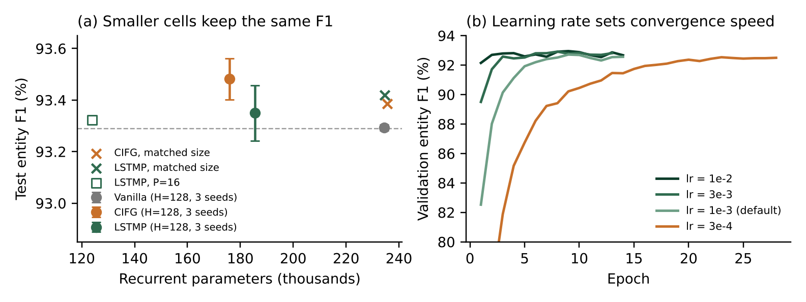

# FloraNER — Named Entity Recognition with LSTM Variants

Lab project — Advanced Natural Language Processing (2026/2027)
Team: Fahd Chaib · Abdallah Alnajjar · Mohamed Taha El Azizi · Mohamed Houssam El Jabbar · Ismail Ibnouazzi

We compare a **vanilla LSTM** with two non-vanilla cells, **CIFG** (coupled input-forget gate) and
**LSTMP** (LSTM with projection), on named entity recognition in French botanical text (FloraNER).
All cells are implemented from scratch with `nn.Linear` (no `nn.LSTM`).

📄 **Report:** [`docs/FloraNER_LSTM_Report.pdf`](docs/FloraNER_LSTM_Report.pdf)

## Results

The smaller cells match the vanilla LSTM with 21–25 % fewer recurrent parameters.

| Cell (H = 128) | Recurrent params | Test entity F1 (%) | Precision (%) | Recall (%) | s / epoch |
| --- | ---: | ---: | ---: | ---: | ---: |
| Vanilla LSTM | 234,496 | 93.29 ± 0.01 | 91.85 | 94.79 | 41 |
| **CIFG** | **175,872 (−25 %)** | **93.48 ± 0.08** | 92.11 | 94.89 | 41 |
| LSTMP (P = 64) | 185,472 (−21 %) | 93.35 ± 0.11 | 92.07 | 94.67 | 48 |

Mean ± standard deviation over 3 seeds (42, 1, 2), coarse-grained test set, recurrent parameters of both directions.

- **Bigger does not help:** CIFG and LSTMP enlarged to the vanilla parameter budget reach 93.39 % and 93.42 %.
- **Even smaller still works:** LSTMP with P = 16 (−47 % parameters) reaches 93.32 %.
- **Hyperparameters** (vanilla cell, one factor at a time): the learning rate matters most (3e-3 → 93.59 %, 3e-4 → 93.01 % and 23 epochs); Adam converges fastest; initialization has a small effect; batch 128 is 4.6× faster per epoch than batch 16 at the same F1.



All runs are in [`results/`](results): `runs/<name>/` holds each run's config, learning curve (`history.csv`) and test metrics (`metrics.json`); `tables/` and `figures/` are produced by `src/aggregate.py`.

## Task and data

- **Dataset:** FloraNER, coarse-grained (`ORGANE`, `DESCRIPTEUR`).
- **Format:** character-level spans are converted to word-level **BIO** tags (`src/data.py`).
- **Preprocessing:** documents (≈254 words on average, up to 1,277) are split into segments at `;` and double spaces (≈14 words on average).
- **Splits:**
  - test = the official test file;
  - validation = 10 % of the training *documents* (fixed seed, identical for all models);
  - one text present in both train and test is removed from train.
- **Metric:** strict **entity-level F1** (same definition as seqeval/conlleval). 79 % of tokens are `O`, so token accuracy is reported but not used for model selection.

## Model

```
Embedding (100) → BiRNN layer built from a custom cell → Dropout → Linear → tag scores
```

| Cell | Equations | Specificity |
|---|---|---|
| Vanilla | (1)–(6) | 4 gates |
| CIFG | (13)–(18) | `i_t = 1 − f_t`, 3 weight blocks (−25 % recurrent params) |
| LSTMP | (19)–(25) | `h_t = W_p m_t + b_p`, recurrent state of size P < H |

`tests/test_cells.py` checks that our vanilla cell matches PyTorch's `nn.LSTM` numerically (max diff ≈ 6e-8), and that padding does not change the outputs, in both directions.

## Repository layout

```
data/{coarse,fine}/{train,test}.csv   FloraNER files (CC BY 4.0)
src/cells.py            Vanilla, CIFG, LSTMP cells (+ an extra WMC cell) and the time loop with padding mask
src/model.py            BiRNN tagger
src/data.py             span → BIO conversion, segmentation, splits, vocabulary
src/metrics.py          entity-level precision / recall / F1
src/train.py            training (early stopping on validation F1), all hyperparameters as CLI flags
src/run_experiments.py  experiment groups (models, matched, lr, optim, init, batch, proj)
src/aggregate.py        result tables + figures
src/eda.py              exploratory data analysis
run_colab.ipynb         one-click Colab runner
results/                all runs, tables and figures used in the report
docs/                   the report (PDF)
```

## Usage

Single run:

```bash
pip install -r requirements.txt
python tests/test_cells.py
python src/train.py --cell cifg --lr 1e-3 --optimizer adam --batch_size 32 --name my_run
```

A group of experiments, then the result tables and figures:

```bash
python src/run_experiments.py --group models
python src/aggregate.py --results results/runs --out results/tables
```

Or open [`run_colab.ipynb`](https://colab.research.google.com/github/Fahd-Chaib/floraner-lstm/blob/main/run_colab.ipynb) in Colab with a T4 GPU.

## Dataset credit

Nainia A., Vignes Lebbe R., Chenin E., Sahraoui M., Mousannif H., Zahir J. (2024).
*FloraNER: a Named Entity Recognition Dataset for Botanical French Text.* Zenodo.
https://doi.org/10.5281/zenodo.12765869 — CC BY 4.0.
